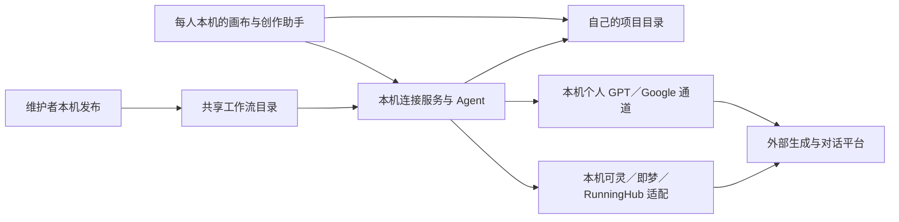

# 本地 AI 创作画布 PRD

版本：1.2。状态：需求基线已确认；本版补充第二轮平台核查、安装授权前置条件与任务归档约束，供后续开发拆解与验收使用，不代表下列功能已经实现。

本版围绕生图、生视频与辅助创作对话，结合用户需求访谈、Craft Anything 调查记录、LibTV 登录后界面观察及当前工作区代码编写。后续开发以本文件的范围、操作规则和验收标准为依据；平台实际能力以真实账号验证为准。

## 1. 产品目标与交付边界

视觉与交互方向补充：整体产品体验以用户指定的 [Lovart 画布](https://www.lovart.ai/canvas) 为主要参考，LibTV 补充生成流程，Cue 提供局部交互灵感。先确认完整画布和统一设计规则，再实现组件，不再分别照搬不同组件的外观。详见 [UI 协作需求](../../ui-collaboration/brief.zh-CN.md)。本补充不改变下列生图／生视频功能范围；Lovart 具体界面尚待与用户共同核验。

### 1.1 一句话定位

每个人安装在自己 Windows 或 macOS 电脑上的 AI 创作画布：使用自己的 GPT／Gemini 账号和少数朋友共用的平台账号，在同一画布里复用参考素材与提示词，完成生图、选图、修改、生视频和本地归档。

### 1.2 要解决的具体问题

| 当前问题 | 首期应达到的结果 |
| --- | --- |
| 反复切换平台、登录和配置 | 首次接入后在画布选择能力使用；授权失效时给出对应平台的恢复入口 |
| 同一参考图反复手动上传 | 导入项目一次，连接到不同节点；应用负责向相应平台传输素材 |
| 复制提示词、改完后找不到原版本 | 节点保留草稿，每次生成保留提示词、参数、参考素材快照 |
| 生成结果分散下载、命名、整理 | 结果自动回到发起节点并存入本地项目目录 |
| 一张图到视频需要跨工具重建输入 | 选中图片直接连到视频节点，指定首帧或尾帧后生成 |
| 新工作流需要逐人配置 | 维护者发布工作流目录，朋友下次打开应用自动同步 |
| 创作想法需要另外打开聊天工具讨论 | 画布侧边栏多轮聊天、分析选中的图片、优化提示词，用户手动应用 |

“导入一次”指不要求用户重复选文件，不承诺不同平台共用一个上传地址。应用按平台、账号和文件有效性处理上传。生成依然依赖外部平台联网服务，本地运行不等于本地模型推理。

### 1.3 用户与角色

- 创作者：你和少数朋友，各自安装应用、保存项目并发起生成。
- 工作流维护者：首期由你负责配置、试运行和发布共享工作流。只拥有目录发布权限，不因此获得朋友的项目或个人账号。
- 接入包准备者：你准备共用平台接入配置包，朋友首次导入；个人 GPT／Gemini 必须各自接入。

首期不建设公共 SaaS、多租户组织、收费系统、实时协作或中心任务服务器。所有 CLI 和本地服务在每个人自己的电脑运行。共享工作流目录可以远程托管，但不承担生成执行。

### 1.4 范围

| 首期必须交付 | 本轮不要求新增或完善 |
| --- | --- |
| Windows、macOS 安装与引导 | 导演台、剧本／分镜生成、智能剪辑 |
| 统一图片／视频节点与参考素材复用 | 音频生成、3D 生成、完整 ComfyUI 编辑器 |
| 文生图、多参考图生成／修改、候选和历史 | 局部重绘、扩图、抠图、超分等高级图片工具 |
| 文生视频、单图生视频、首尾帧生视频 | 多参考图／角色参考视频作为必需模式 |
| 个人 GPT／Gemini，可灵、即梦、RunningHub | Liblib 深化接入、Tripo3D 完整生成流程 |
| RunningHub 配置、试运行、发布、自动同步 | 全图自动运行、上游变化自动生成下游 |
| 本地项目目录、结果归档、项目包分享 | 公共素材库、项目云同步、实时协同 |
| 任务恢复、明确选择 API 备用渠道 | 自动换平台、自动付费兜底、自动重新提交 |
| GPT 创作助手及手动应用提示词 | 聊天自动改图、自动组织节点或执行生成 |

已有的高级工具、Agent、音频、3D 和独立工作台不因本 PRD 被删除；本轮不借机重构或扩展。画布是主入口，独立工作台继续作为辅助入口并复用生成能力。

## 2. LibTV 调查与本项目取舍

### 2.1 证据边界

- Craft Anything 采用 Clean room 观察。其独立浏览器未进入用户私有项目，转到公开首页；可支持公开首页和登录边界结论，不能支持私有画布内部实现结论。
- 登录后功能来自另一次浏览器界面观察及截图。打开了图片、视频、脚本等入口；没有运行付费生成，没有验证生成质量、速度或所有工具的执行结果。临时节点已撤销。
- 本地功能来自代码阅读、现有待验收记录和此前界面观察；“代码存在”“曾运行成功”“已经全面验收”分别记录。
- 原调研曾建议优先导演／分镜功能，已被本次用户确认的生图、生视频优先级替代，不沿用旧路线图。

### 2.2 可借鉴的操作与设计

| 已观察到的 LibTV 行为 | 观察中的操作方式 | 本项目采用方式 |
| --- | --- | --- |
| 图片节点配合上下文生成面板 | 新增图片 → 选节点 → 上传／选画布参考 → 提示词 → 模型参数 → 生成 | 复用本项目图片节点和提示词面板，合并平台入口 |
| 参数随模型选择呈现 | 图片参数包括画质、分辨率、背景、比例、数量 | 只显示当前通道真正支持的参数，不照搬固定档位 |
| 视频模式与参考输入关联 | 视频节点选择模式；缺少参考图时部分模式不可用 | 明确文生、单图、首尾帧输入要求，缺输入时就地提示 |
| 上传与画布引用并列 | 在生成面板选参考素材，可从现有画布取图 | 保留拖入、选图、连线与参考条；明确参考角色 |
| 功能分层 | 常用生成就近操作，完整工具在工具菜单 | 主面板只保留高频生成操作，详细记录和工具折叠 |
| 深色网格画布、悬浮工具栏、圆角面板 | 围绕媒体节点操作 | 借鉴层级与操作距离，沿用本项目现有浅／深主题，不复制皮肤 |
| 故事板、导演助手、角色库、后期工具 | 可切换面板和查看入口 | 仅列入后续参考，不纳入首期交付 |

观察到单节点适配缩放过大、生成面板可能越出视口；本项目应保证选中节点时关键输入和生成按钮可见。工具菜单存在不代表工具执行效果已验证。

### 2.3 本项目的核心差异

本项目的重点是个人本地安装、多平台账号接入、用户自有项目目录和可共享的工作流配置。不能仅仿照 LibTV 界面：必须补齐跨平台能力差异、凭据管理、任务中断和结果落盘这些本地使用环节。

## 3. 当前实现与差距

以下是本次阅读范围内的现状，不代表未知插件或其他分支没有相应功能。旧 TODO 与待验收记录有历史性重叠，按已记录的最新验证事实描述，不把旧条目当成当前运行结论。

| 能力 | 当前依据与状态 | 本期处理 |
| --- | --- | --- |
| 画布与媒体节点 | `web/src/types/canvas.ts` 已有图片、视频、文本、配置、分组及扩展节点；图片有候选和主图字段 | 复用，不重建画布框架 |
| 参考连线 | 通用连线只有起止节点；平台任务另有输入角色映射 | 增加统一的参考角色和生成快照语义，不能只靠连线先后猜首尾帧 |
| 多图与历史 | 已有 `images`、`primaryImageId` 等字段；尚不能据此认定具备统一的跨批次、跨平台历史 | 补齐生成批次、候选、选中输出、溯源；视频使用相同规则 |
| 个人 GPT 生图 | 连接服务已有原生图片调用；待验收文档记录用户成功生成过 GPT 图片 | 继续验收参考图、数量、尺寸、额度错误与双系统使用 |
| Google 生图 | 现有生图路径是 Antigravity；记录已有 Google AI Pro 真实生图，参考图等仍待验收 | 面向用户呈现 Gemini 生图；实现保留真实通道名称，不将 Gemini CLI 对话冒充生图 |
| GPT 对话 | `canvas-agent` 已通过 `codex app-server` 处理线程、流式消息、历史和画布工具 | 复用并收敛为创作助手；不另做终端文本抓取，不默认开放自动执行 |
| 共用平台 | `canvas-connectors` 有可灵、即梦 CLI 及 RunningHub API 等适配；真实账号完整验收未完成 | 首先验收可灵、即梦、RunningHub；不能把连接通过写成生成可用 |
| 平台入口 | `connectors:task` 独立平台任务节点；预设支持模型、远端 ID、参数 | 普通能力进入图片／视频面板，特殊工作流保留独立节点 |
| RunningHub | 已有上传、输入映射、提交、查询与输出类型处理；配置表单仍以 JSON 为主 | 做可视化配置、真实试运行、版本发布和目录同步 |
| 任务恢复 | 连接任务已有 requestId、remoteId、状态持久化；CLI 中断有待核查路径 | 统一用户状态、恢复查询、下载重试与结果去重，逐通道验证 |
| 项目存储 | 项目／素材主要使用浏览器本地存储；服务另存任务与结果文件 | 新项目以用户选定目录为持久化依据，浏览器缓存不能是唯一副本 |
| 分享 | 现有 ZIP 导出会收集项目中的 storageKey 资源 | 复用打包工具，扩展到输入、所有历史输出、参数快照并排除凭据 |
| 安装 | 已有 Windows x64 安装包工作与验收记录 | 补齐 macOS 包与双系统完整体验；不声称当前已有同等完成度 |

主要代码入口见附录。此 PRD 不要求删除现有 WebDAV 等功能，但首期不能把它们作为本地目录保存或朋友分享的必经路径。

## 4. 产品结构与核心路径

### 4.1 页面职责

| 位置 | 主要职责 |
| --- | --- |
| 项目入口 | 新建／打开本地项目、最近项目、导入项目包 |
| 画布 | 导入参考素材、创建节点、连线、预览、生成、选结果 |
| 节点生成面板 | 提示词、参考条、平台／模型／工作流、受支持参数、生成状态 |
| 节点候选与历史 | 本批候选、历史批次、原始参数、设为当前输出、拖出独立节点 |
| 任务列表 | 查看排队／运行／待确认／归档状态，定位发起节点，恢复和手动重试 |
| 创作助手侧栏 | 聊天、选图分析、提示词优化、明确目标后应用到节点 |
| 账号与连接 | 个人登录、共用配置包导入、连接检测、额度／授权状态、手动 API 备用 |
| 工作流库 | 使用已同步工作流；维护者添加、配置、试运行、发布和查看同步结果 |

这些是职责划分，不要求全部新增独立页面。优先利用现有面板和设置入口，避免把技术细节铺在主画布。

### 4.2 首次使用

1. 安装并打开应用，选择项目保存目录。
2. 在账号引导中连接个人 GPT／Google 账号；缺少工具时显示安装动作和完成标志。
3. 导入共用接入配置包，逐平台显示“已配置／需登录／可用／异常”，仅为缺失环节提供补充操作。
4. 加载工作流目录。目录为空也能进入画布，不显示虚构工作流。
5. 创建项目，拖入图片，创建图片／视频节点开始使用。

检测和导入不能自动发起付费生成。引导必须写清准备内容、操作位置、按钮名称、成功结果和下一步；普通用户不需要理解 MCP、驱动或协议。

### 4.3 首期主验收路径

导入参考图 → 在创作助手讨论并手动应用提示词（可跳过）→ 图片节点选择 GPT、Gemini、可灵、即梦或 RunningHub 工作流 → 生成候选 → 选图并继续修改 → 选中结果连接视频节点 → 指定单图或首尾帧模式 → 生成并播放视频 → 自动归档 → 关闭并重开恢复 → 导出项目包给朋友。

流程中由应用处理上传、查询和下载。常规成功路径不要求用户去平台网页下载文件、再回画布上传。

## 5. 功能需求

### F01 安装、账号与平台接入

- Windows 和 macOS 都是首期交付对象。以当前技术栈与本地服务为基础，安装后从应用入口打开，不要求普通用户手动运行开发命令。
- 账号归属与授权状态在设置中管理；生成入口只展示具体平台、模型和工作流，不采用“个人通道／共用通道”分类或固定的账号归属后缀。个人凭据不随共享包发布。
- 共用配置包支持可携带的账号配置、工作流目录地址等。不能假定 CLI 会话可跨设备复制；不支持时保留已导入配置并引导官方登录，不冒充已连接。
- 配置包不包含原电脑的绝对 CLI 路径，工具在每台电脑重新定位。
- 连接状态、具体能力、额度分别判断。无法读取余额时显示未知，不能显示为零或无限。
- 引导按“检测工具 → 安装缺失工具 → 官方登录或填写 Key → 检查连接与能力 → 进入创作”展示操作位置、按钮、成功结果与下一步。网页登录成功不等于本机 CLI 授权；配置包导入也不等于真实生成验证。
- 当前 RunningHub 适配走 API，使用其 Key 和账号对应权限；仍属于本机向外调用，不增加中心服务器。
- 账号包只向指定朋友分发；使用带加密能力的成熟封装方案，导入时解锁。本地凭据隔离保存，工作流目录和项目包不携带凭据。具体存储实现列入技术设计，不声称现有 JSON 已加密。
- 当前 OpenAI 兼容 API Key 仍存于浏览器并由前端发起请求；开发本期账号管理时必须区分现状与目标，不能仅改文案宣称凭据已安全迁移。

### F02 统一生成能力选择

- 显示名称采用 GPT、Gemini、可灵、即梦、RunningHub 工作流；工作流展示实际名称，例如“RunningHub 工作流 · 工作流名称”。接入协议放设置详情，不要求用户选择 CLI／MCP／API 才能生成；API 备用渠道显示 AIHubMix 等真实服务名称与计费来源。
- 图片、视频节点分别只显示匹配输出和模式的能力；可灵、即梦、RunningHub 等保留来源标识。
- 同一节点换平台时保留提示词和本地参考素材；重新校验数量、类型、角色和参数。不能静默丢参考图、改首尾帧或改模式。
- 不支持的选项禁用或不提供，并就地解释；不要先让用户提交再以通用报错结束。
- 当前平台失效、模型下线或额度不足时保留用户原选择。只在用户主动选择后更换通道。
- 展示平台能提供的计费信息。未知成本明确标注，不伪造精确价格；切到付费 API 后仍需用户点击生成。
- CLI 将尺寸、数量等作为提示要求而非强制参数时，界面与结果信息须区分“请求值”和“实际输出”。不保证模型严格满足。

### F03 参考素材与手动连线生成

- 支持拖入本地文件、从项目选素材、从画布连接节点；原文件被移动后项目副本仍可用。
- 图片参考按可见顺序展示，可移除和调整；首帧、尾帧使用显式槽位，允许交换。
- 下游引用图片节点当前选中的输出。上游更换选图后，下游待提交参考随之更新并提示，已有结果继续保留。
- 点击生成时冻结提示词、参数、参考素材及其角色。运行中修改上游或草稿，不影响已经提交的任务。
- 不允许节点自引用；同一素材重复连接时避免重复传输，但相同文件分别用于首帧和尾帧时必须保留两个角色。
- 素材缺失、数量超出能力或类型不支持时，在提交前说明具体问题。各平台约束以能力验证为准，不新增未经确认的统一上限。

### F04 图片生成与修改

- 文生图、多张参考图生成／修改为首期模式；由支持该模式的通道承接，不要求每个平台都支持所有模式。
- 在同一节点编辑提示词、参数、参考图并再次生成，形成新批次，不覆盖历史成功结果。
- 选中的候选可明确“作为参考继续修改”，应用准备对应输入，不隐式混入所有历史图片。
- 数量选择遵循通道实际能力。部分成功时保留成功图片，区分未返回、失败和仍在运行，不把整批误记为完全成功。
- 候选缩略图用于浏览，查看原图、导出和提交参考使用原始文件，尊重原比例。

### F05 视频生成

- 首期支持文生视频、单图生视频、首尾帧生视频。每种模式必须至少有一条经过验证的可用通道才能称为交付。
- 文生视频不要求图片；单图模式明确一张起始图；首尾帧模式明确两张图及角色。不得因输入多了一张图就静默改模式。
- 时长、比例、分辨率、数量及原生音轨选项按能力提供。模型自带音轨不等于新增音频生成工作台。
- 视频结果可在节点播放、查看基本信息、设为当前输出、重新生成和从历史恢复选择。
- 首期不承诺视频直接输入聊天、多参考角色一致性、剪辑成片或视频后期工具全覆盖。

### F06 候选、批次与历史

- 每次用户提交是独立批次，有独立任务记录、输入快照和结果集合。
- 原节点默认仅显示当前输出与轻量候选入口；展开后查看同批候选和历史批次，避免把每张结果自动铺满画布。
- 首次没有当前输出时可选首个成功结果；已有当前输出时不因新结果到达自动替换，由用户选定后再影响下游待提交参考。此为本 PRD 的交互设计建议。
- 拖出结果形成普通图片／视频节点，保留来源任务信息；不再次生成，也不删除原节点历史。
- 切换历史结果不重新调用平台。可从历史恢复提示词和参数为新草稿；只有点击生成才创建新任务。
- 删除节点不能被解释为取消远端任务或立刻删除所有原文件。仍被其他节点、历史或任务引用的文件不得清理。

### F07 任务状态、恢复与费用

任务内部提交身份必须在外部调用前保存；平台任务标识返回后立即落盘。一次用户提交只对应一次外部生成意图，刷新与重新打开不能新建生成。

| 用户可见状态 | 含义与可用动作 |
| --- | --- |
| 准备中／正在上传／正在提交 | 本地准备及平台接收阶段；重复点击不重复提交 |
| 排队中／生成中 | 平台已接收；按能力查询，显示真实进度或不确定进度 |
| 正在保存结果 | 平台完成，尚在下载和写入项目，不宣称已完整归档 |
| 已完成／部分完成 | 本地可用结果已保存；可查看、选取和导出 |
| 查询暂时失败 | 保留原任务身份，提供恢复查询；不等于生成失败 |
| 保存失败 | 保留远端任务和已下载文件，提供重新下载／选择可写目录，不重新生成 |
| 状态待确认 | 提交结果或进程终态不确定；核查原任务后由用户决定是否重新提交 |
| 生成失败 | 平台明确失败；展示原因，用户可编辑后发起新批次 |
| 已取消 | 只有平台或本地任务确认取消才显示；停止等待不等于取消远端生成 |

- 重新打开后，对可查询的原任务自动恢复查询和下载。无法恢复的 CLI 任务保留现场信息并显示待确认。
- 网络错误不触发自动重新生成。手动重新提交要使用新的任务身份并保留旧记录。
- 同一输出多次查询或下载完成，只归档／导入一次。结果始终归属于发起项目、节点和批次，不写入当前恰好打开的另一个画布。
- 平台不支持取消时，不显示可取消的承诺。取消是否退费由平台决定。
- 可灵官方指南明确生成提交后不可取消、结果链接有效期为 24 小时。停止本机等待仍保留原任务，取得结果后及时下载原文件。链接失效时尝试查询原任务取得可用链接；无法取得则显示保存失败及原因，不自动重新生成。刷新链接能力待实测，不承诺一定可恢复。
- 应用可展示本机多个任务；不能声称掌握朋友电脑上的完整队列。共用账号并发、排队与额度由平台约束，本期不增加跨电脑调度服务器。
- 本期没有确认新的并发数、超时、自动查询重试次数、文件大小上限。实施前按 AGENTS.md 说明环节、默认值和失败处理并取得确认，不把经验值写成默认产品规则。

### F08 本地项目目录与分享

- 用户选择保存位置后，新项目以磁盘目录中的项目数据、素材和任务记录为持久化依据，自动保存。浏览器 localforage 可作缓存和 UI 状态存储，不承担唯一项目副本。
- 界面显示“正在保存／已保存／保存失败”，保存失败时不得给出已安全退出的错误印象。
- 每份参考素材先复制入项目；生成原文件和历史输出自动归档。不能只保存会过期的远端 URL。
- 断网可打开已有项目、编辑草稿和预览本地结果；生成、平台查询、首次授权和目录更新仍需联网。
- 项目包包含画布布局、引用关系、输入文件、全部保留的结果、生成参数与工作流配置快照；排除密钥、会话令牌、接入包和发布权限。
- 在另一台电脑导入为独立项目；预览不需要原作者账号。再次生成需接收者自行具备对应通道和权限。
- 项目分享不移交远端任务控制权。导入的未完成任务保留为来源记录，不自动查询或重新提交；已下载结果正常显示。
- 跨系统使用项目相对路径。移动完整项目目录后，通过“打开项目”仍能恢复；只移动部分素材时明确报告缺失。
- 新项目按新结构设计，不自动迁移或清除旧浏览器数据，不新增旧字段兼容层。用户确需迁移旧项目包时，另行确认迁移范围。
- 项目导出和共用接入配置包是不同操作；共用平台自身的历史可见性不受本地项目隔离控制。

### F09 RunningHub 工作流配置与试运行

- 首批生产工作流清单明确留空，见第 10 节。不安装虚构示例冒充可用能力。
- 维护者填写工作流／应用标识、名称、用途、输出类型、适用生成模式和功能说明。
- 配置提示词、参考素材与平台字段的映射，定义普通用户能调的参数、类型、默认值、必填项和平台约束。
- 优先采用明确字段和表单配置；复杂原始映射放高级区。平台不能提供可读取的参数定义时，支持维护者手动填写，不承诺自动理解任意 ComfyUI 图。
- 单一图片／视频输出且能适配统一输入的工作流进入对应节点选择器；特殊输入、多个具名输出或多媒体组合使用独立工作流节点。首期只要求图片／视频工作流。
- 独立节点显示所需输入槽位和各输出集合，输出可拖成普通节点继续使用；不丢弃第二个输出。
- 试运行前展示实际测试输入和可获取的计费信息；点击试运行才发起真实任务。连接检查或模拟响应不能代替成功试运行。
- 发布版本需通过实际输入上传、生成、下载、输出类型和映射校验，记录成功试运行依据；无可用真实工作流时保留草稿，不能发布为已验证。
- 试运行证据在维护者本地保存。共享目录不自动发布测试参考图、私人提示词或生成文件。

### F10 工作流版本、发布与自动同步

- 工作流有稳定 ID 和不可变版本；变更映射、默认值或说明时发布新版本，不直接改写历史版本文件。
- 本 PRD 推荐用可读的版本化目录与工作流配置文件，避免另建团队后台。存放位置及发布适配留给技术设计，发布应能在应用内完成；不能最终仍要求维护者手工复制配置文件。
- 发布权限只保存在维护者本机；使用者只有目录读取能力。配置只描述允许的输入／参数／输出，不能携带任意命令或脚本自动执行。
- 应用下次启动自动检查并同步有效更新；不要求朋友逐项确认。保留可查看的更新摘要和手动重新同步入口，不依赖固定在线的个人电脑。
- 下载、校验成功后整体切换到新目录版本；网络错误、损坏文件、版本不兼容时保留上一份可用目录，不阻塞项目打开。
- 新建节点使用最新可用版本；已经保存的节点草稿继续绑定原版本并显示可升级。升级由用户主动选择，参数无法对应时要求补齐后才能生成。此为避免更新改写创作意图的设计建议。
- 运行中的任务及历史使用提交时快照，不随目录更新变化；取消发布或下架工作流不删除用户历史。
- 本地保留快照不保证 RunningHub 远端工作流不变。远端被删、权限收回或字段变化时标记不可用并给出原因；维护者需新建可用版本。
- 共用凭据更新与目录同步分开。工作流目录里不存 Key；凭据失效时重新导入接入包或完成登录。

### F11 GPT 创作助手

用户已补充确认：首期包含普通多轮聊天、选图分析、提示词优化，以及手动应用到节点；不自动执行生成。

- 复用现有侧边栏和 `canvas-agent` 的 Codex app-server 通道，各人使用自己的账号。GPT 是模型选择，Codex CLI／app-server 是接入方式，产品不让用户在这两者之间做伪二选一。
- 提供新建会话、多轮上下文、流式回复、停止回复和本地历史恢复。会话按项目归属，不自动混入另一项目的素材。
- 用户明确选择图片或节点作为本轮上下文，输入区显示将发送的引用；不默认上传整个项目。
- 图片分析仅在选定通道具备能力时提供。首期不承诺视频原文件理解、ChatGPT 网页历史同步、网页记忆或网页全部功能。
- 优化后的提示词作为可查看、可复制的建议。点击“应用到节点”并明确目标后才写入节点草稿；不会修改历史快照，也不会触发生图／生视频。
- 会话生成建议期间切换项目、改变选中节点或删除目标时，应用操作仍需核对原目标，不得写到当前随机选中的节点。
- 普通对话不调用画布写入、生成或任意本机命令。提示词约束之外还需在工具权限层收敛现有 Agent 能力。
- 对话记录本地保存；分享项目默认不含聊天历史，避免把私人讨论意外打包。此为本 PRD 的隐私设计建议，首期无需新增会话云同步。
- 记录模型和通道，模型目录不等于账号权益已验证；额度或授权问题显示恢复入口，不自动转付费 API。
- GPT 对话模型与 GPT 生图通道分别选择，切换聊天模型不隐式更改生图模型。Google 对话保留已有能力，本轮不要求复制所有 GPT 助手交互到第二套面板。

接入依据：现有项目已使用 app-server；官方文档将其用于产品内对话、历史、审批和流式事件集成。官方同时提供 Sign in with ChatGPT 的 app-server 接入方案；本期先复用已有通道，若后续更换认证路径需独立验证权限、模型和工具，不连带修改生图路径。[App Server 文档](https://learn.chatgpt.com/docs/app-server)、[ChatGPT 登录集成](https://developers.openai.com/siwc/token-sharing-open-source/codex-app-server)。

## 6. 交互与视觉要求

延续本项目 `canvasThemes`、`useThemeStore` 和 Ant Design token，支持现有浅／深主题，不引入另一套视觉系统。

- 顶部工具栏扁平、轻量，无装饰性边框、阴影和胶囊背景；选中态与普通按钮区分。
- 图片／视频以内容为主。节点下方或邻近区域展示提示词和生成控制，靠近视口边缘时调整位置，不让按钮越出可操作范围。
- 生成面板按“参考素材 → 提示词 → 能力与参数 → 生成”组织。首尾帧身份在参考缩略图旁直接可见。
- 生成入口显示 GPT、Gemini、可灵、即梦、RunningHub 工作流及实际模型／工作流名称，不出现“共用通道”“个人通道”分类，也不固定附加“我的账号／共用账号”。账号归属、CLI／MCP／API 等细节放设置中；实际计费来源仍需可见。
- 候选和历史按需展开，默认不展开大图库，不持续占用画布空间。图片保持原比例，视频有明确播放状态。
- 任务进度就近显示；全局任务列表用于定位和恢复，不另建复杂调度后台。
- 创作助手侧栏可收起，引用图片可见。建议与“应用到节点”动作相邻，应用后可在节点核对，生成按钮仍独立。
- 成功、缺输入、未登录、额度不足、下载失败等状态给出具体下一步；原始 CLI 输出和日志进入折叠详情。
- 键盘导航、焦点、图标提示及常见窗口尺寸下的可操作性纳入验收；Ctrl／Cmd 按系统显示。现有浏览器和其他项目页不因启动或验收被关闭。

## 7. 数据与执行边界

本节给出产品必须保留的数据关系，不要求建立复杂的新框架或逐表实现。开发可沿用已有类型与存储模块，以满足行为为准。

| 对象 | 必须保留的信息 | 关键约束 |
| --- | --- | --- |
| 项目 | 标识、目录、画布布局、节点、连线、素材引用、格式版本 | 用户磁盘目录是新项目权威副本，不依赖原电脑绝对路径 |
| 素材 | 标识、本地相对位置、媒体类型、来源、必要尺寸／时长 | 保存原文件；预览可重建，不能代替原图 |
| 生成节点 | 当前草稿、选择的能力、参考角色、当前选中输出、批次列表 | 节点移动／展示与生成记录分开 |
| 生成批次／任务 | 提交身份、发起项目与节点、提示词、参数、输入快照、通道、远端标识、状态 | 不含账号密钥；每次提交的输入不可被后续编辑覆盖 |
| 结果 | 稳定输出标识、所属任务、本地文件、实际媒体信息、保存状态 | 同一远端结果重复查询只归档一次 |
| 工作流版本 | 稳定 ID、版本、远端 ID、输入映射、参数定义、输出定义、验证状态 | 版本不可变，远端对象仍可能变化 |
| 工作流目录 | 发布者、目录版本、工作流版本引用、兼容条件、更新摘要 | 无项目素材、个人提示词或凭据 |
| 连接配置 | 通道身份、认证方式、凭据引用、工具位置与能力状态 | 实际凭据本机独立保存，工具位置每台机器重新检测 |
| 对话 | 项目归属、会话、turn、item、明确引用、草稿建议与目标 | 实时补充与历史权威快照不可重复合并；不自动共享 |

关系：项目包含节点和素材；节点引用素材并发起任务；任务冻结输入并产生结果；节点选择一个结果作为当前输出；工作流版本描述如何调用平台，不承担个人项目存储。

### 7.1 推荐执行结构

这是按现有实现提出的技术方向：复用 `web`、`canvas-connectors`、`canvas-agent`，补齐项目文件管理和工作流发布／读取。不是增加一台所有人依赖的中心电脑。

前端仍按项目规范从 `web/src/services/api/` 统一访问外部通道或已有本地接口，不能假设新增云后端。浏览器不能直接执行 CLI，文件访问和凭据能力应由现有本地服务的受限接口承接。安装后的 UI 是否使用桌面壳或本机浏览器由技术设计选择，不把某个壳框架视为用户已指定。

### 7.2 主要取舍

| 已考虑方式 | 本期选择与原因 |
| --- | --- |
| 集中电脑调用／每人本地调用 | 用户明确选择每人本地调用；没有中心执行依赖，但无法从本机统一控制账号的所有并发 |
| 每平台一种节点／统一媒体节点 | 用户选择统一图片／视频节点，特殊工作流单独节点，减少换平台时重建输入 |
| 浏览器持久化／本地项目目录 | 用户选择项目目录，便于恢复和分享；需要实际文件访问能力，不能仅改存储名称 |
| 手工分发工作流／目录自动同步 | 用户选择应用启动自动同步；维护者发布，运行任务与历史仍绑定快照 |
| 重新做聊天／复用 Codex app-server | 推荐复用现有对话基础，收敛工具权限；具体模型能力按账号验证 |

不预先指定数据库、打包格式内部字段、远端目录托管商或全部 API 路径。实现时使用成熟的文件打包、配置校验和凭据存储能力，不手写底层协议或加密。

### 7.3 平台接入决策

CLI、MCP 和 API 不是互斥方案：CLI 可在内部使用 MCP 或 HTTP API；MCP 是工具调用协议，不提供额外会员权限。用户点击生成后直接按已选参数执行，不能为了接 MCP 增加一轮 LLM 决策。

| 界面入口 | 本期默认方式 | 已核实的其他方式与约束 | 实施缺口 |
| --- | --- | --- | --- |
| GPT 对话／生图 | 对话复用 Codex app-server；生图复用本机 Codex 原生图片适配 | 对话与生图分别选择能力，不自动切 API；依据当前代码和验收记录 | 创作助手工具权限收敛、图片引用与双系统验收 |
| Gemini 生图 | 复用 Antigravity 生图适配 | 当前 Gemini CLI 是对话入口，不把对话能力当生图 | 参考图、实际参数和双系统验收 |
| 可灵 | 国内官方 CLI `@klingai/cli-cn` | 官方 CLI 本身通过 MCP 服务调用；直接 MCP 可接但不是本期默认实现；REST API 权益单独核查 | 真实账号能力、任务与原文件下载验收 |
| 即梦 | 优先验证当前 `dreamina` 独立 CLI | `dreamina-canvas` 涉及远端画布，需独立适配；未核实官方独立 MCP 执行契约 | 当前代码尚未接 `frames2video`；新旧 CLI 的账号可用性须分别确认 |
| RunningHub 工作流 | 官方 Workflow／AI App HTTP API | 官方 RH CLI 也存在且需 API Key；已核实的 Developer Kit MCP 只读，不发起生成 | 具体工作流选择、参数配置、真实运行及发布同步 |

可灵 CLI 与 MCP 关系见[官方 Skill](https://raw.githubusercontent.com/klingai-tech/skills/main/SKILL.md)。即梦独立生成及首尾帧命令见[官方 CLI 说明](https://lf3-static.bytednsdoc.com/obj/eden-cn/psj_hupthlyk/ljhwZthlaukjlkulzlp/dreamina_cli_beta/SKILL.md)。RunningHub 区分工作流／应用与直接模型调用的 Key 权益，见[官方 API 文档](https://www.runninghub.cn/runninghub-api-doc-cn/)；其 [RH CLI](https://github.com/HM-RunningHub/RH_CLI) 使用 API Key，[Developer Kit MCP](https://raw.githubusercontent.com/HM-RunningHub/ComfyUI_RH_OpenAPI/main/developer-kit/mcp-server/README.md) 明确当前只读。

默认方案已在本节明确，不能把所有平台的接入形式继续留成笼统待定；待验证的是账号权益、具体模式和端到端行为。完整来源、旧调研复用边界及代码差距见[平台接入核查与选择](../../../research/platform-access-decision.md)。

第二轮只读核查确认：当前 Windows 连接服务未找到可灵／即梦 CLI，RunningHub 尚未配置凭据；浏览器的 RunningHub“消费级-会员”页面已有掩码密钥，可用于工作流和 AI 应用，消耗付费积分并与网站任务共用并发。会员 Key 存在不代表本机已经接通。可灵公开指南已由 Craft Anything 捕获，登录页面与 LibTV 资产库由独立浏览器观察，详见[第二轮核查](../../../research/platform-readiness-round2.md)。本轮未安装、授权或生成，也未验证 macOS。

## 8. 可执行验收标准

模拟验证用于检查流程和失败分支，真实账号验证用于确认权限、参数和结果。两者不能互相代替；以下为后续验收要求，本次撰写未运行这些测试，也未消费平台额度。

| 编号 | 对应需求 | 场景与预期 |
| --- | --- | --- |
| A01 | F01 | 在 Windows 和 macOS 的独立用户环境安装，从入口打开，完成保存目录选择和连接引导；不要求手动启动开发命令 |
| A02 | F01 | 两个人分别连接个人 GPT／Google，账号互不串用；导入相同共用接入包后正确识别本机工具与缺失授权，不带入另一电脑的路径 |
| A03 | F01、F02 | 检测成功但无生成额度时不能显示生成已验证；Key／登录失效显示对应恢复步骤，配置检查不生成内容 |
| A04 | F02 | 生成入口按 GPT、Gemini、可灵、即梦、RunningHub 工作流及实际名称展示，无个人／共用通道分类；同一节点切换平台保留提示词与参考图，不兼容参数明确指出，不偷偷换模型或删图 |
| A05 | F03、F04 | 导入多张参考图、排序、生成候选，选中一张继续修改；新批次保留旧结果和原始输入快照 |
| A06 | F05 | 文生视频、单图生视频、首尾帧分别通过至少一个已验证通道完成；缺图时阻止提交，交换首尾帧后实际请求角色一致 |
| A07 | F03、F06 | 图片连接视频后更换上游选图，下游提示参考变化；旧视频保留，不产生新生成请求，用户点击后使用新图 |
| A08 | F03、F06 | 任务执行中修改提示词、参考图或工作流目录，旧任务仍按原快照执行；结果回原批次，新草稿不被覆盖 |
| A09 | F06 | 候选和历史在原节点展开，选图即时更新当前输出；拖出结果生成独立节点，不重复调用、不丢历史 |
| A10 | F04、F06 | 平台只返回部分候选时保留成功结果，显示真实数量及未完成情况；已有选中输出不被异步结果无意替换 |
| A11 | F07 | 连续点击生成、刷新页面、重复查询同一任务不会重复提交或重复导入结果 |
| A12 | F07 | 取得任务 ID 后断网并重新打开，恢复查询同一任务；没有任务 ID 且提交不确定时保持待确认，不自动重投 |
| A13 | F07、F08 | 平台完成但磁盘不可写／下载中断，显示保存失败；恢复下载后获得文件，不重新消耗一次生成 |
| A14 | F07 | 切换或关闭发起画布后任务完成，结果仍归属原项目；发起节点已删除时保留任务结果入口，不写入其他画布 |
| A15 | F02、F07 | CLI 失败或额度不足，保留输入并提供重试／换平台／API 选择；没有用户主动选择和提交就不调用备用付费 API |
| A16 | F08 | 移动外部原参考文件，项目内参考仍可用；重开项目恢复布局、选中结果、历史、原图和视频 |
| A17 | F08 | 断网打开项目能浏览已保存媒体和编辑草稿；联网任务显示不可用原因而非丢失项目 |
| A18 | F08 | Windows 导出项目包、macOS 导入及反向操作均可恢复媒体和参数；无需原作者账号预览，包内没有凭据或默认私聊历史 |
| A19 | F08 | 导入项目包里的未完成任务不自动查询或生成；再次生成由接收者选择自己的可用通道 |
| A20 | F09 | 维护者配置一个真实工作流，完成提示词／图像映射、参数表单、试运行和发布；朋友无需编辑 JSON 即可使用 |
| A21 | F09 | 一个普通图片／视频工作流进入统一节点，特殊多输出工作流进入独立节点；所有配置输出可识别和取回 |
| A22 | F10 | 发布新版本后朋友重新打开应用自动获取；原任务和历史不变，已有节点提示可升级，新建节点使用新版本 |
| A23 | F10 | 目录不可达、内容损坏或版本不兼容时使用原目录，项目仍能打开；更新不携带或执行任意命令 |
| A24 | F09、F10 | 发布失败不暴露半成品目录；未试运行工作流仍是草稿；目录里无测试素材、Key、发布凭据 |
| A25 | F11 | 同一项目内完成多轮聊天、停止回复、重开恢复历史；切换项目不会混入其他项目会话，消息不重复 |
| A26 | F11 | 选中图片作为引用后分析并优化提示词；仅明确选中的内容作为上下文，权限或模型不支持时给出真实提示 |
| A27 | F11 | 回复只产生建议；点击应用才改变指定节点草稿，旧生成历史不变，节点不自动生成；目标删除或切换时不误写 |
| A28 | F11 | 普通聊天不能绕过界面规则调用生成／画布写入／本机命令；聊天失败不自动使用付费备用渠道 |
| A29 | 全部 | 浅／深主题、常见窗口尺寸和 Ctrl／Cmd 操作均可用；生成面板和候选展开不遮住关键操作，技术日志默认收起 |

首批真实工作流未选定前，A20／A21 的生产工作流验收标记为待提供实例；可先完成管理、同步和模拟流程，但不能据此宣称某个具体工作流已经可用。

首期成功标准：核心流程不需要人工重复搬运提示词、参考图和生成文件；本地成果重开可用；双系统能够分享；没有无意的重复生成、自动付费切换和任务归属错误。生成速度与质量受平台影响，本 PRD 不虚设耗时或质量保证。

## 9. 开发顺序与交付检查点

这些是同一首期内的工作顺序，不把 macOS、恢复或工作流管理自动降级为未来需求。后续实施计划应逐项引用 Fxx／Axx。

| 阶段 | 主要工作 | 完成检查点 |
| --- | --- | --- |
| P0 接入与方案验证 | 核实双系统 CLI 安装、个人图片／对话能力、可灵／即梦／RunningHub 权益；确定目录读写和发布方式 | 形成真实能力矩阵，标明哪些模式已验证、哪些阻塞；不以安装成功替代生成验收 |
| P1 本地项目与任务基础 | 项目目录、素材副本、提交快照、任务归属、归档状态、恢复与项目包 | 对应 A11～A19；生成结果不会因刷新、跨项目切换或下载失败丢失 |
| P2 生图／生视频闭环 | 统一能力入口、显式参考角色、候选和历史、三种视频模式；接入优先平台 | 对应 A04～A10，主创作路径完整 |
| P3 工作流库 | 配置表单、映射、试运行、版本、发布、启动同步与失效处理 | 对应 A20～A24；首批清单空缺如实保留 |
| P4 创作助手与整体验收 | 复用现有会话，图片引用与提示词建议，手动应用，工具权限收敛；双系统安装与完整回归 | 对应 A01～A03、A25～A29，逐项记录真实验证结果 |

创作助手以现有实现为基础，可在依赖稳定时穿插完善；不发展成自动导演或通用开发 Agent 项目。无须为了准备 PRD 修改产品代码、重装插件或创建新分支。

## 10. 待补信息与验证事项

### 10.1 首批 RunningHub 清单

用户明确暂未选好，清单保持空白。这不阻塞工作流库设计；具体工作流适配与真实发布验收需后续补充。

| 工作流名称／ID | 用途 | 输入与可调参数 | 输出／节点入口 | 试运行结果 |
| --- | --- | --- | --- | --- |
| 待维护者提供 | 待补 | 待补 | 待补 | 未进行 |

### 10.2 实施前需解决的事项

| 事项 | 谁来解决 | 如何影响交付 |
| --- | --- | --- |
| 各账号可用模式、模型、额度与参数约束 | 开发核对官方接口并用用户授权账号验证 | 不支持的能力不可显示为可用；整体三种视频模式仍须有通道覆盖，否则明确交付缺口 |
| 共用 CLI 授权能否跨设备导入、多机使用行为 | 开发逐平台验证 | 不支持复用时转首次官方登录；不能承诺配置包消除所有登录 |
| Windows／macOS 支持版本与 CPU 架构 | 开发提出适配矩阵，与用户确认设备覆盖 | “双系统”不能只用一台 Windows 通过来代替；具体架构未在访谈指定 |
| 工作流目录存放位置、可用的发布凭据 | 开发先选最小可行托管／发布方案，再由维护者提供目标和权限 | 不阻塞本地配置页开发，但真实发布、朋友自动同步需要远端来源 |
| 并发、查询节奏、超时、重试和文件限制 | 开发给出方案，用户确认实际行为边界 | 不在本 PRD 中新增任意默认值，不承诺控制其他电脑的共享账号任务 |
| 本地目录写入、原子保存、凭据保护与配置包格式 | 开发技术设计 | 必须满足 F01／F08 行为；使用成熟库，保护现有用户数据 |
| 新旧项目数据边界 | 按本 PRD 先支持新项目 | 不静默覆盖旧数据；确需旧数据迁移时单独确认，不顺带做兼容层 |
| 创作助手账号／模型与图片输入能力 | 开发验证现有 app-server 通道 | 不保证 ChatGPT 网页所有模型、工具和历史在此可用 |

技术验证遇到阻塞时，保留用户原输入和配置并记录缺口。不能用浏览器自动登录、未公开接口或另一付费通道静默代替尚未实现的接入。

### 10.3 本文新增的设计建议

以下用于把已确认需求变为可开发规则，属于文档作者的设计选择，不冒称访谈逐项确认：已有输出不被新结果自动替换；已有节点绑定工作流版本并主动升级；项目分享默认不带聊天与远端任务控制权；目录采用版本化配置发布；共用接入包加密且凭据分离。开发若需改变这些行为，应同步修改 PRD 与验收案例。

## 11. 文档与变更管理

- 本 PRD 是当前生图、生视频及创作助手迭代的范围依据。旧的五平台接入和 GPT 生图设计可作为实现参考，但不扩大本期范围。
- 完成实现后，将对应事项从 `docs/content/docs/progress/todo.mdx` 移入 `pending-test.mdx`，记录实际可测试内容，按项目规则同步中文版本；用户验收通过后再更新正式功能说明。
- 产品行为发生变化时，按仓库规则更新 CHANGELOG 的 Unreleased；本次仅新增规划文档和待办，不把计划写成已发布功能。
- 不把原调研中的导演／分镜优先路线带入本期。新需求写明影响的 Fxx、验收案例和优先级后再纳入计划。
- 不在本 PRD 中写密钥、Cookie、个人账号标识、完整调试日志或真实测试素材。

## 附录 A：本地代码依据

以下链接以本文件所在目录为基准，可在仓库内定位：

- [节点、连线与当前媒体字段](../../../web/src/types/canvas.ts)
- [画布项目与浏览器持久化](../../../web/src/stores/canvas/use-canvas-store.ts)
- [项目 ZIP 导出与资源收集](../../../web/src/lib/canvas/canvas-export.ts)
- [前端连接服务契约](../../../web/src/services/api/connectors.ts)
- [平台任务节点定义](../../../web/src/components/connectors/connector-definitions.tsx)
- [当前连接与任务预设配置界面](../../../web/src/components/connectors/connector-manager.tsx)
- [RunningHub 上传、映射与任务适配](../../../canvas-connectors/src/providers/runninghub.mjs)
- [本地连接服务、账号与生图说明](../../../canvas-connectors/README.md)
- [现有 Codex 对话与 app-server 接入](../../../canvas-agent/README.md)
- [Windows 打包入口与现状](../../../packaging/windows/README.md)
- [当前待验收记录](../../content/docs/progress/pending-test.zh-CN.mdx)
- [既有平台接入设计](platform-connectors-design.md)

## 附录 B：调研证据索引

目标：用户提供的 [LibTV 画布](https://www.liblib.tv/canvas)。下列证据为之前调研的留存，不代表对网站未来版本的持续保证。

证据保存在调研电脑本地：`[local research path omitted]`。其他电脑不会自动拥有这些文件；本文第 2 节已保留必要结论，不依赖截图才能理解需求。

| 来源 | 证据 | 支持范围 |
| --- | --- | --- |
| Craft Anything | `craft-capture-result.json`、`public-capture/`、`investigation.cany/` | 未登录首页捕获与调查过程 |
| Craft 记录 | `ev_b8157f7ab7054f35991a068e4d131018e3fb93dfe4765db886e8bfc7b3457149` | 独立浏览器访问目标后转到公开首页 |
| Craft 记录 | `ev_fb23ceedfc77153cccd0b94621a0bdac61c061d8c66fe58681ccdac77ed4a38c` | Clean room 首页捕获，不用于推断私有画布样式 |
| 登录后 UI 观察 | `01-canvas.png`、`02-tools.png`、`03-node-menu.png` | 画布外观、工具分类和节点入口 |
| 登录后 UI 观察 | `04-image-node.png`、`05-image-settings.png` | 图片节点、参考入口、参数面板 |
| 登录后 UI 观察 | `06-video-node.png` | 视频模式、参考要求及参数入口 |
| 登录后 UI 观察 | `07-storyboard.png` 至 `11-character-library.png` | 故事板、脚本步骤和角色库，仅作后续参考 |
| 操作回收 | `12-restored.png` | 撤销临时节点后的空画布 |
| 本地 UI 观察 | `13-local-canvas.png`、`14-local-image-node.png` | 原有画布与图片面板基础 |
| 综合记录 | `research-notes.json` | 观察步骤、代码入口与未验证范围；其中旧优先级已被本 PRD 替代 |

本次 PRD 未重新触发平台生成。样式精确数值、实际生成品质、全部后期工具、整图自动执行与大画布性能仍不属于已验证的 LibTV 事实。

